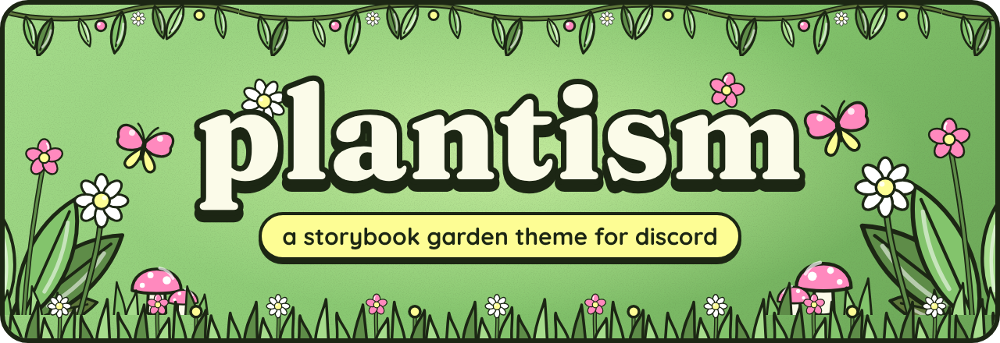
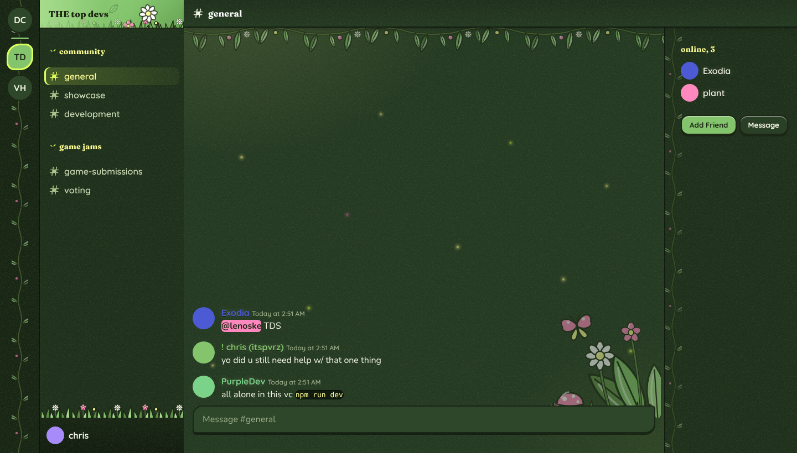
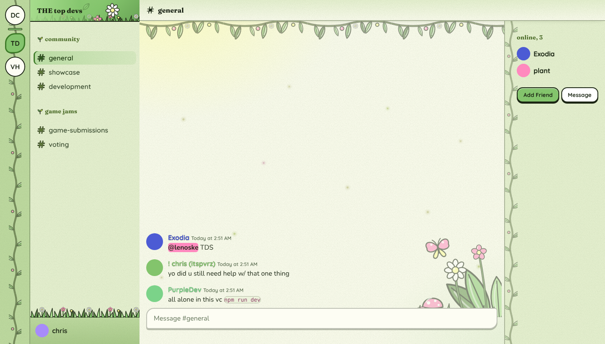
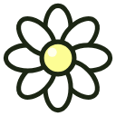
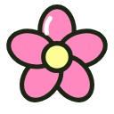
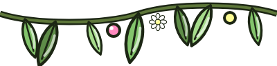
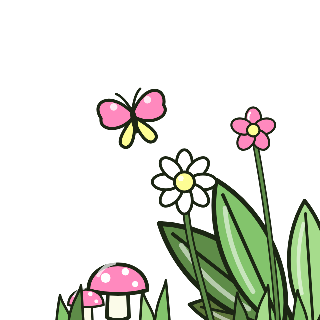
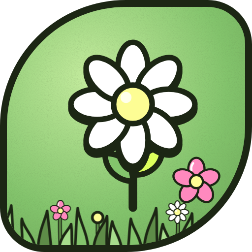

<div align="center">



<br>
<br>

<a href="https://github.com/pvrzz/plantism/stargazers"></a>
<a href="https://github.com/pvrzz/plantism/network/members"></a>
<a href="https://github.com/pvrzz/plantism/commits/main"></a>


<br>


<br>
<br>

**a storybook garden for your discord.**<br>
hand-drawn flowers, hanging vines, fireflies at night and pollen in the sun.

<br>

[**install**](#-plant-it) · [**two moods**](#-two-moods) · [**features**](#-whats-growing) · [**customize**](#-tend-your-garden) · [**the garden**](#-the-garden)

</div>

<br>

## 🌙 two moods

plantism follows whatever mode discord is in. every color in the theme is tuned twice, once for each.

<table>
<tr>
<td width="50%" align="center"><b>🌙 night garden</b><br><sub>dark mode</sub></td>
<td width="50%" align="center"><b>☀️ sunlit meadow</b><br><sub>light mode</sub></td>
</tr>
<tr>
<td></td>
<td></td>
</tr>
<tr>
<td align="center"><sub>deep forest greens, butter-yellow headings, drifting fireflies</sub></td>
<td align="center"><sub>parchment chat, sage sidebars, deep fern headings, pollen sparkles</sub></td>
</tr>
</table>

<br>

## 🌱 plant it

<details open>
<summary><b>Equicord / Vencord</b> (recommended)</summary>
<br>

**online theme** (updates on its own)

1. open **Settings → Themes → Online Themes**
2. paste this link and save:

```
https://raw.githubusercontent.com/pvrzz/plantism/main/plantism.theme.css
```

**local file**

1. download [`plantism.theme.css`](https://raw.githubusercontent.com/pvrzz/plantism/main/plantism.theme.css)
2. **Settings → Themes → Open Themes Folder**, drop it in
3. flip plantism on

</details>

<details>
<summary><b>BetterDiscord</b></summary>
<br>

1. download [`plantism.theme.css`](https://raw.githubusercontent.com/pvrzz/plantism/main/plantism.theme.css)
2. **Settings → Themes → Open Themes Folder**, drop it in
3. flip plantism on

</details>

<br>

## ✨ what's growing

<table>
<tr>
<td width="50%" valign="top">

**🎨 look + feel**
- two full palettes, auto-switching with discord's mode
- **650+ plant icons** replacing discord's own, glossy and ink-outlined with little sprouts, color-coded (pink for danger, butter for stars + gifts, lime for checks)
- chunky cartoon buttons that press in when clicked
- butter-yellow tooltips, petal-pink mentions + badges
- paper grain texture instead of flat colors
- server icons bloom into petals on hover
- no blurple left anywhere it can reach

</td>
<td width="50%" valign="top">

**🌼 the garden**
- a vine canopy hanging over the chat
- ferns, daisies, mushrooms + a butterfly in the corner
- grass and flowers growing over your user panel
- vines climbing the server list + member list
- a swaying daisy on every server banner
- fireflies (dark) and pollen (light) drifting by
- sprouts next to every category

</td>
</tr>
<tr>
<td valign="top">

**🔤 type**
- **Fraunces** for headers, server names + sections
- **Quicksand** for channels, buttons + ui
- **Nunito** for messages

</td>
<td valign="top">

**🖥️ fits every window**
- ultrawide down to snapped half-windows
- decorations scale down or tuck away when space is tight
- respects reduced motion + your chat font size

</td>
</tr>
</table>

<br>

## 🪴 tend your garden

drop any of these into **QuickCSS** (or the top of the theme) to make it yours.

```css
:root
{
    --plant-section-case: uppercase;
    --plant-corner-size: 320px;
    --plant-chat-corner: none;
    --plant-chat-garland: none;
    --plant-panel-grass: none;
    --plant-rail-vine: none;
    --plant-members-vine: none;
    --plant-header-daisy: none;
}
```

| variable | what it does | default |
| :-- | :-- | :-- |
| `--plant-section-case` | casing for category + section titles | `none` |
| `--plant-corner-size` | size of the corner garden in chat | `260px` |
| `--plant-chat-corner` | the corner garden (`none` hides it) | ferns + flowers |
| `--plant-chat-garland` | the vine canopy over chat | garland |
| `--plant-panel-grass` | grass over the user panel | grass |
| `--plant-rail-vine` | vine behind server icons | vine |
| `--plant-members-vine` | vine along the member list | soft vine |
| `--plant-header-daisy` | swaying daisy on server banners | daisy |
| `--plant-category-bullet` | sprout next to categories | sprout |
| `--plant-moss` `--plant-lime` `--plant-butter` `--plant-petal` | the core palette | 🌿 |

<details>
<summary><b>tune the moods</b></summary>
<br>

each mode has its own set of `--p-*` colors. override them inside `.theme-dark` or `.theme-light`:

```css
.theme-dark
{
    --p-chat: #2a4226;
    --p-garden-opacity: 0.7;
    --p-fireflies: 0.5;
}

.theme-light
{
    --p-chat: #fbfcef;
    --p-fireflies: 0;
}
```

</details>

<br>

## 🌸 the garden

every piece is hand-drawn with the same ink outline. PNGs live in [`assets/`](assets), SVG sources in [`assets/src/`](assets/src).

<div align="center">
<table>
<tr>
<td align="center"><br><sub>daisy</sub></td>
<td align="center"><br><sub>bloom</sub></td>
<td align="center"><br><sub>leaf</sub></td>
<td align="center"><br><sub>sprout</sub></td>
<td align="center"><br><sub>vine</sub></td>
</tr>
<tr>
<td align="center" colspan="2"><br><sub>grass</sub></td>
<td align="center" colspan="3"><br><sub>garland</sub></td>
</tr>
<tr>
<td align="center" colspan="5"><br><sub>corner garden</sub></td>
</tr>
</table>
</div>

<br>

## 📈 growth

<div align="center">
<a href="https://star-history.com/#pvrzz/plantism&Date">

</a>
</div>

<br>

## 🐛 found a weed?

discord renames its classes a lot, so a spot can slip back to default colors after an update. [open an issue](https://github.com/pvrzz/plantism/issues) with a screenshot and where it happened, and it gets pulled.

<br>

<div align="center">



**grown by [pvrz](https://pvrz.lol)**<br>
<sub>if plantism made your discord a little greener, leave a ⭐</sub>

</div>
